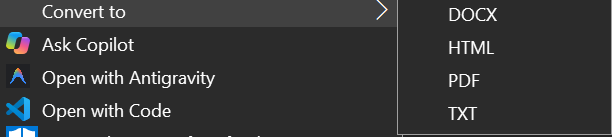
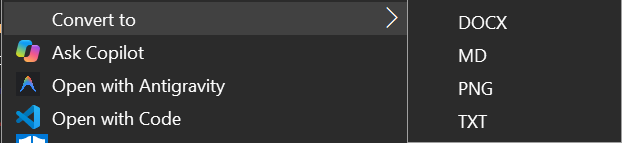

# EZConvert

Convert files from the Windows right-click menu, offline and with formatting kept.

Right-click a file → **Convert to** → pick a format. The new file appears next to the original, and a small notification shows when it's done.

| Right-click a Markdown file | Right-click a PDF |
| --- | --- |
|  |  |

## What it converts

| From | To |
| --- | --- |
| Markdown (`.md`) | PDF, DOCX, HTML, TXT |
| Word (`.docx`) | PDF, Markdown, HTML, TXT |
| PDF | DOCX, Markdown, TXT, PNG (one image per page) |
| Text (`.txt`) | PDF, DOCX, Markdown, HTML |
| Images (PNG, JPG, WEBP, BMP, GIF, ICO, TIFF) | PNG, JPG, WEBP, BMP, ICO, PDF |

- **Formatting is kept:** Headings, bold, italic, lists, tables, code blocks and links.
- **Markdown → PDF output:** Looks like GitHub's rendering, with bordered tables and clean headings.
- **Nothing is overwritten:** If `notes.pdf` already exists, you get `notes (1).pdf`.
- **Multi-select works:** Select several files and convert them together. They're processed one at a time.
- **Fully offline:** No accounts, uploads or ads.

## Requirements

- Windows 10 (1809+) or Windows 11.
- [Python 3.10+](https://www.python.org/downloads/), with "Add to PATH" ticked during install.
- **Microsoft Word**, only for DOCX → PDF.
- **Microsoft Edge**, for Markdown → PDF. It comes with Windows.

## Install

Paste this into **PowerShell**:

```powershell
irm https://raw.githubusercontent.com/khan-shayan9/EZ-Convert/main/install.ps1 | iex
```

It downloads the latest release to `%LOCALAPPDATA%\EZConvert`, installs the Python packages, and adds the right-click menu. Run the same command again to update. You can [read the script](install.ps1) first if you like.

**Manual install:** Download the zip from [Releases](https://github.com/khan-shayan9/EZ-Convert/releases/latest) and extract it to a folder you'll keep. Then double-click **`setup.bat`**. The menu points at that folder, so if you move it, run `setup.bat` again.

## Use

- **Right-click menu:** Right-click a supported file and choose **Convert to** → format. On Windows 11, open **Show more options** first, or press Shift+F10.
- **Drop window:** Run `python ezconvert.py`, drop files on the window, and click a format.
- **Command line:** `python ezconvert.py --to pdf notes.md report.md`

## Uninstall

```powershell
irm https://raw.githubusercontent.com/khan-shayan9/EZ-Convert/main/uninstall.ps1 | iex
```

This removes the menu and the install folder. For a manual install, run `python install_menu.py --uninstall` in its folder instead. The menu only uses your user registry keys (`HKCU`), so no admin rights are needed.

## Limitations

- **PDF → DOCX / Markdown:** This rebuilds the structure, such as headings, lists and tables, and won't match the PDF's exact layout. Scanned PDFs with no text layer give rough results.
- **DOCX → Markdown:** Code blocks lose their language tag.
- **DOCX → PDF and Markdown → PDF:** Each takes a few seconds because Word or Edge starts in the background.

## How it works

| Conversion | Engine |
| --- | --- |
| Markdown ↔ DOCX, DOCX → HTML/MD | [pandoc](https://pandoc.org) (bundled via `pypandoc_binary`) |
| Markdown → PDF | pandoc → styled HTML → Edge headless print |
| DOCX → PDF | Microsoft Word (via `docx2pdf`) |
| PDF → Markdown / DOCX | [PyMuPDF4LLM](https://github.com/pymupdf/pymupdf4llm), then pandoc |
| Images | [Pillow](https://python-pillow.org) |

## License

MIT
